<div align="center">

# DC_Recomp

**A native Windows and Linux port of *Dark Cloud* (NTSC-U, `SCUS-97111`), made by statically recompiling the game's PlayStation 2 code to C++.**<br>
Not an emulator: the game's own MIPS R5900 code, rebuilt as a native program on a reimplementation of the PS2 hardware.


</div>

> [!IMPORTANT]
> No game files are included: no ELF, overlays, IRX modules, data archives, or code generated from them.
> You need **your own copy** of the North American release, PS2 ID **`SCUS-97111`** (disc version 1.02). The port is
> built against that disc's files:
>
> | File | SHA-1 |
> |---|---|
> | `SCUS_971.11` | `d9965d6908a334a5dfc982f3384428ad42048d54` |
> | `TITLE.BIN` | `8da27dd6a4f8d2090216b17d5d64a0c142cfd6d5` |
> | `DUN.BIN` | `ab7e56a4eeb69e178638088de6e57857d48f1d98` |

## Status

**Bring-up, not playable yet.** On the full native path the game boots, finds its memory card, plays its 3D intro,
shows the title screen and its attract demo, and New game plays the opening in the Dark Shrine (name entry,
Colonel Flag, the Dark Genie) at 56-60 fps with music. A total recompilation like the other ports of the fork: the game's code, its overlays, its IOP modules
and its VU1 microcode all run as native code, drawn by the native GS renderer. Nothing is emulated, and paraLLEl-GS is
not used.

| Milestone | |
|---|:---:|
| Function map from the ELF's own symbol table (main program and both overlays, no Ghidra) | ✅ |
| Recompile the main ELF and link it with the PS2Recomp runtime (Windows) | ✅ |
| Code overlays `TITLE.BIN` and `DUN.BIN` (one load slot, picked by their header) | ✅ |
| VU1 microcode compiled ahead of time (`ps2_vu_aot`) | ✅ |
| Boot: EE kernel, CD reads from the disc files, memory card detected | ✅ |
| The game's IOP modules recompiled to native code (9 modules, nothing interpreted) | ✅ |
| Intro, title screen, in-game 3D scenes after the title (native GS renderer) | ✅ |
| New game: name entry, the Dark Shrine opening (Colonel Flag summons the Genie) | ✅ |
| Norune village | ⏳ |
| First dungeon (Divine Beast Cave) | ⏳ |
| Sound and music: SDRDRV, EzMIDI and LIBSD native, voice transfers complete | 🔧 |
| Native frame loop (no vblank pacing): 60 fps on the PC clock | ✅ |
| Memory card saves | ⏳ |
| Linux build | ⏳ |
| Widescreen, higher internal resolution | ⏳ |

✅ works · 🔧 in progress · ⏳ not reached yet

[docs/RECOMP_NOTES.md](docs/RECOMP_NOTES.md) records how the port is brought up, every fix and how it was found, and
what remains open.

## Screenshots

The first boots on the full native path (native GS renderer, native IOP modules, recompiled overlays):

| | | |
|---|---|---|
| 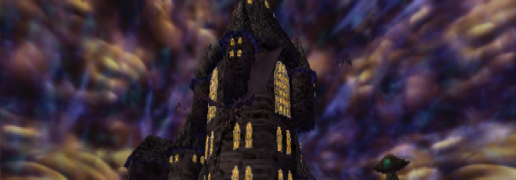 | 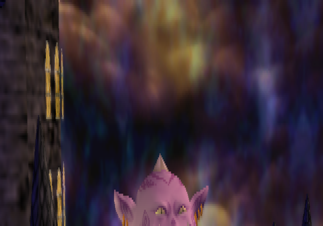 | 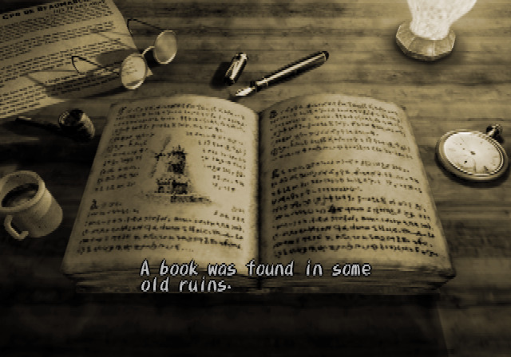 |
|  | 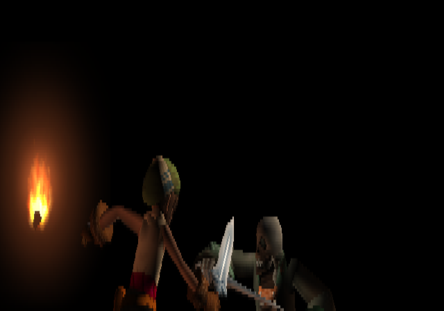 | 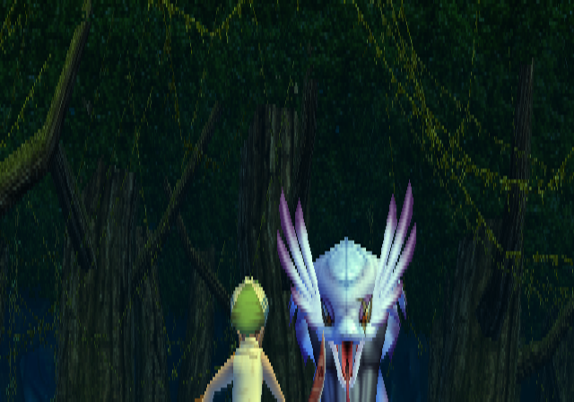 |
| 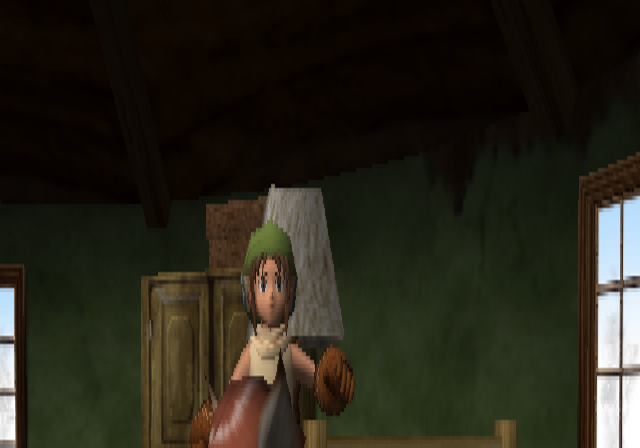 | 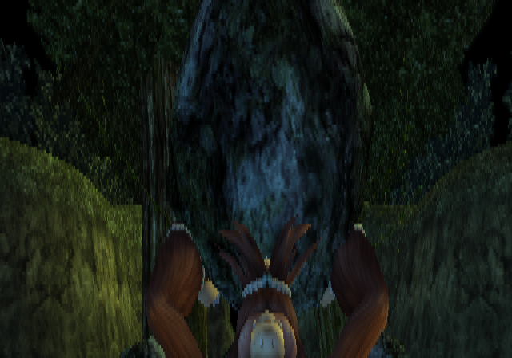 | 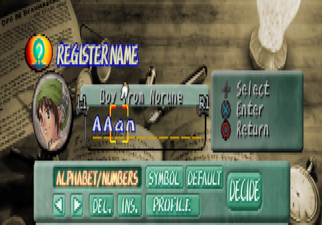 |
| 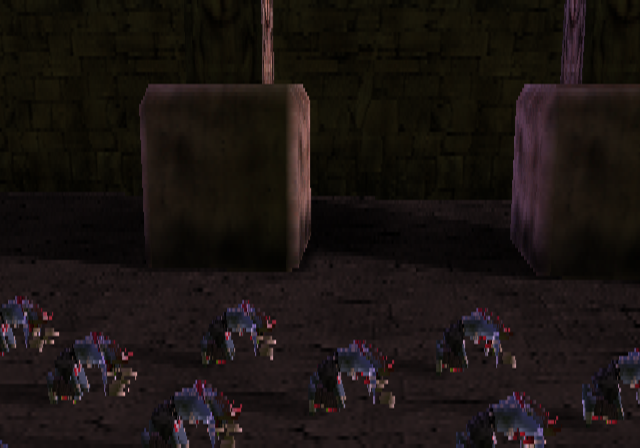 | 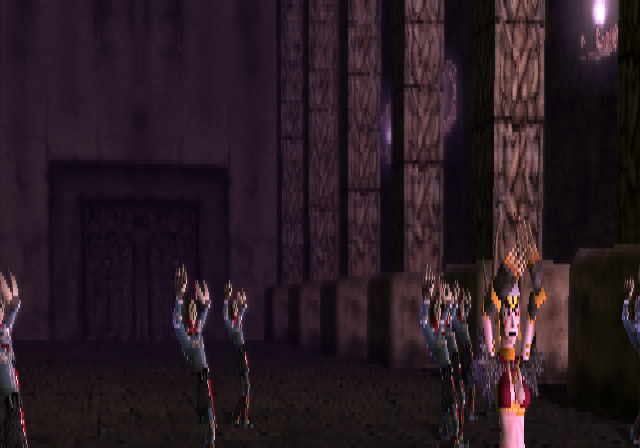 | 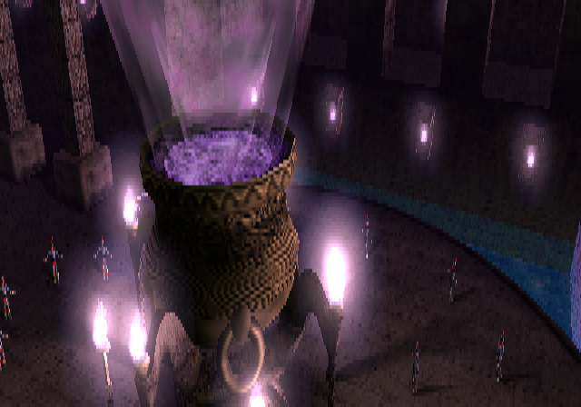 |
| 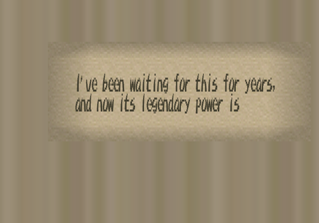 | 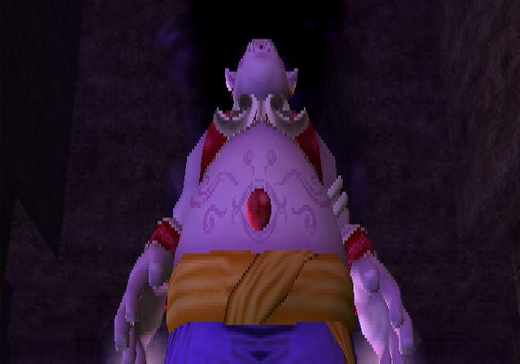 | |

## How it works

```
disc files (game/) ──► tools/symtab_map.py (the ELF's symbol table) ──► recomp/maps/dc_main.csv
                   ──► ps2_analyzer ──► recomp/dc_scus97111.toml
                                           │
                     ps2_recomp ──► C++ (one file per function, generated/) · ps2_vu_aot ──► VU1 microcode (generated/vu1/)
   TITLE.BIN, DUN.BIN ──► tools/wrap_elf.py + tools/symtab_map.py ──► ps2_recomp in module mode ──► generated/overlays/
   the game's IRX (dumped by a first run) ──► the fork's tools/iop_recomp.py ──► generated/iop/
                                           │
                 CMakeLists.txt ──► PS2Recomp runtime + generated code + runtime/dc_overrides.cpp
                                           │
   PS2Recomp runtime: EE kernel HLE · DMAC · GIF · native GS renderer (OpenGL) · VIF/VU0/VU1 · IPU ─┼─► ps2EntryRunner
   PS2Recomp IOP:     the game's own IRX as native code · SPU2 and IOP on the PC clock · SIO2
```

- The retail executable keeps its symbol table (CodeWarrior): every function has its name and size, for the main
  program and for the two overlays, whose sections are empty in the ELF. `tools/symtab_map.py` turns it into the
  function maps ps2_recomp reads, so no Ghidra pass is needed.
- `TITLE.BIN` and `DUN.BIN` are CodeWarrior `MWo3` modules that both load at `0x01DABD00`. Each is recompiled as a
  PS2Recomp overlay module; at run time the one whose header is in guest memory is called.
- The top-level `CMakeLists.txt` builds the fork's runtime, swaps its placeholder function table for the generated one
  and links everything into `ps2EntryRunner`.
- `runtime/dc_overrides.cpp` holds the game-specific bindings.

The PS2Recomp fork lives in `PS2Recomp/` (git submodule, [boubou666/PS2Recomp](https://github.com/boubou666/PS2Recomp),
branch `dc/native`, cut from `native/renderer`), shared with the *Twisted Metal: Black*, *The Third Age*,
*Jade Cocoon 2*, *Valkyrie Profile 2* and *Drakengard* recompilations.

## Requirements

- Windows 10/11 with [MSYS2](https://www.msys2.org/) (UCRT64, see below) or Linux
- CMake 3.21+, Ninja, GCC 13+ or Clang with C++20
- FFmpeg development libraries (`libavcodec`, `libavformat`, `libavutil`, `libswresample`, `libswscale`) and `pkg-config`
- `bsdtar` (libarchive) to extract the disc, Python 3
- A CPU with AVX2 (the runtime is built for `x86-64-v3`)
- Your own copy of `SCUS-97111` (check the hashes above)

## Build and run

```bash
git clone --recurse-submodules https://github.com/boubou666/DC_Recomp.git
cd DC_Recomp
scripts/extract_iso.sh "/path/to/Dark Cloud (USA).iso"   # disc files -> game/
scripts/build_tools.sh                                   # ps2_recomp, ps2_analyzer, ps2_vu_aot -> build/tools
scripts/recomp.sh                                        # ELF + recomp/dc_scus97111.toml -> generated/
scripts/overlays.sh                                      # TITLE.BIN, DUN.BIN -> generated/overlays/
scripts/build_runtime.sh                                 # runtime + generated code -> build/game
scripts/run.sh                                           # ps2EntryRunner game/SCUS_971.11
```

### Windows

The same scripts run in an MSYS2 **UCRT64** shell, with MSYS2's GCC (MSVC is not supported for this port).

```bash
pacman -S --needed mingw-w64-ucrt-x86_64-{gcc,cmake,ninja,pkgconf,ffmpeg,libarchive,python} git
```

`scripts/stage_dlls.sh` copies the DLLs the runner needs next to `ps2EntryRunner.exe`, so it can also be started
outside the MSYS2 shell.

`scripts/analyze.sh` regenerates the TOML from scratch; it discards manual edits, so diff before committing.

## Disc facts

| | |
|---|---|
| Boot ELF | `SCUS_971.11`, entry `0x100008`, one segment at `0x100000` (1.6 MB of code and data, BSS up to `0x1DABD00`), symbols kept |
| Code | `0x100000-0x2452B8` (EE code), `0x245300-0x24FB00` (VU microcode), `0x29FE80-0x2A1010` (static initializers) |
| Overlays | `TITLE.BIN` (177 functions) and `DUN.BIN` (62 functions), CodeWarrior `MWo3`, both at `0x01DABD00` |
| Video mode | NTSC |
| IOP modules | `MODULES/*.IRX`: SIO2MAN, PADMAN, MCMAN, MCSERV, LIBSD, SDRDRV, MODMIDI, MODHSYN, EZMIDI (and the unused network stack: INET, AN986, LIBNET, NETCNF, MSIFRPC, USBD) |
| IOP image | `MODULES/IOPRP211.IMG` |
| Data | `DATA.DAT` (1.7 GB archive) with its indexes `DATA.HED` and `DATA.HD2` |

## Sharing the machine with other ports

Several PS2Recomp ports are developed on the same machine. A game run or a build takes the shared bench lock
(the fork's `PS2Recomp/tools/bench_lock.sh`, file `D:/ps2recomp_bench.lock`) first, so that another port's build or
game does not skew it:

```bash
scripts/bench_run.sh 5 "boot test" scripts/run.sh                       # a game run: one slot
scripts/bench_run.sh --alone 20 "runner build" scripts/build_runtime.sh # a build: the bench alone
```

## Repository layout

| Path | Contents |
|---|---|
| `recomp/` | Recompiler config (analyzer output plus manual additions) and the function map |
| `runtime/` | Game override module (game-specific bindings) |
| `scripts/` | Extract, build tools, analyze, recomp, overlays, build runner, run, bench lock |
| `tools/` | `symtab_map.py` (function maps from the ELF's symbols), `wrap_elf.py` (overlay to ELF, from VP2S_Recomp), `sync_tree.py` (fast sync of generated code) |
| `docs/` | Bring-up notes |
| `PS2Recomp/` | PS2Recomp fork (submodule) |

Everything derived from the game (`game/`, `generated/`, `build/`, disc images, captures) is git-ignored. Never commit or
redistribute it.

## Credits

- [PS2Recomp](https://github.com/ran-j/PS2Recomp) by ran-j and contributors (GPL), the recompiler and runtime this port is built on.
- The *Twisted Metal: Black*, *The Third Age*, *Jade Cocoon 2*, *Valkyrie Profile 2: Silmeria* and *Drakengard*
  recompilations, developed on the same PS2Recomp fork; runtime fixes are shared.
- *Dark Cloud* © Sony Computer Entertainment, developed by Level-5. This is an unofficial fan project, not affiliated
  with or endorsed by them.
